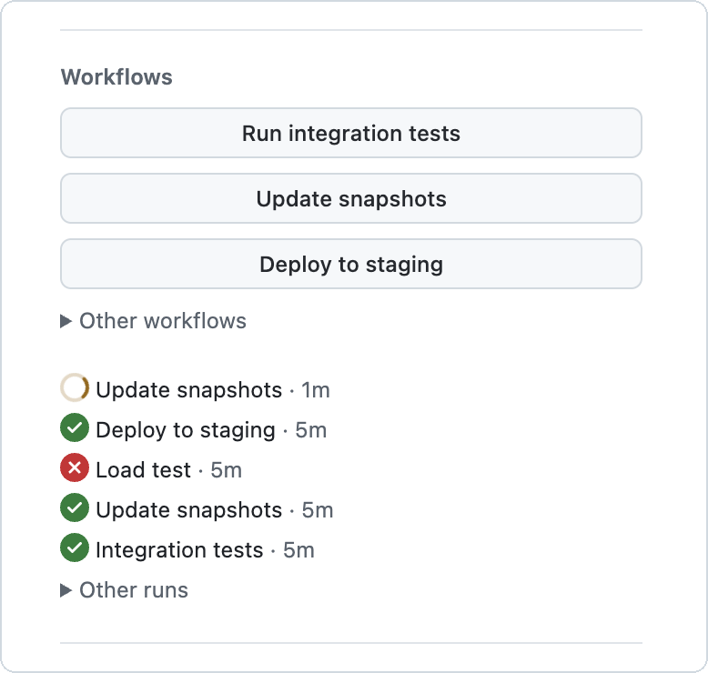

# GitHub PR Buttons



A Chrome extension that adds a **Workflows** section to the pull request sidebar on github.com. A repo lists buttons in `.github/pr-buttons.yml`. Each button dispatches a workflow on the PR's head branch and then opens the new run.

Use it for workflows you run on demand, instead of label triggers: screenshots, a slow test suite, a preview deploy.

Below the buttons is a list of the latest dispatched runs of those workflows on the PR's head commit, whoever started them. `workflow_dispatch` runs do not show in the PR's checks, so this is where you see them. Runs on older commits are in a collapsed "Other runs" section. On hover, each run shows an icon button: cancel while it is queued or running, re-run failed jobs when it failed, and re-run all jobs when it was cancelled.

<br clear="right">

## Install

1. Download [`github-pr-buttons.zip`](https://github.com/frolic/github-pr-buttons/releases/latest/download/github-pr-buttons.zip) from the [latest release](https://github.com/frolic/github-pr-buttons/releases/latest) and unzip it.
2. Open `chrome://extensions`, turn on **Developer mode**, and click **Load unpacked**. Select the unzipped folder.

There is no token to set. The extension uses your github.com session: it reads the same pages and submits the same forms as the Actions tab, so it can do what you can do there, and runs are attributed to you. It sends nothing anywhere but github.com.

To update, download the zip again, replace the folder's contents, and click the reload button on the extension's card.

## Configure a repo

Add `.github/pr-buttons.yml`. The extension reads it from the PR's head commit, so a PR can add or change its own buttons.

```yaml
# yaml-language-server: $schema=https://raw.githubusercontent.com/frolic/github-pr-buttons/main/schema.json
buttons:
  - label: Render screenshots
    workflow: screenshots.yml
    description: Shown as the button's tooltip.
    inputs:
      some-input: value
    paths:
      - 'apps/web/**'
      - '!**/*.md'
```

The first line points editors at [`schema.json`](schema.json): VS Code with the YAML extension and JetBrains IDEs then check the file and complete its fields as you type.

- `label`: the button text.
- `workflow`: the workflow file name in `.github/workflows/`. The workflow must have a `workflow_dispatch` trigger.
- `description` (optional): the tooltip.
- `inputs` (optional): `workflow_dispatch` inputs.
- `paths` (optional): when the PR changes no matching file, the button moves into a collapsed "Other workflows" section below the others. The rules are the same as a workflow's `on.pull_request.paths`: `*` does not match `/`, `**` does, a pattern that starts with `!` excludes, and the last pattern that matches a file decides. A renamed file counts under its new name. A button without `paths` is always in the main list. List the source paths that make the button useful; they do not need to match the workflow's own trigger paths.

When a button cannot work, it is disabled and the reason shows under it: a missing or invalid field, a workflow file that is not on the branch, a workflow without a `workflow_dispatch` trigger, an input the workflow does not declare, or a required input that is missing. The other buttons still work. Only YAML that cannot be read, or a file without a `buttons` list, replaces the whole section with an error.

## Writing the workflow

The workflow runs from the PR's head branch, so it uses that branch's copy of the workflow file. In the workflow, `github.event_name` is `workflow_dispatch` and `github.ref_name` is the head branch. There is no `github.event.pull_request`. To find the PR, look it up by branch:

```sh
gh pr list --head "$GITHUB_REF_NAME" --state open --json number --jq '.[0].number'
```

A workflow that skips draft PRs with `github.event.pull_request.draft == false` also skips dispatched runs. Use `github.event_name != 'pull_request' || !github.event.pull_request.draft`.

Buttons are disabled on PRs from forks, because a workflow cannot be dispatched on a fork's branch.

## Limits

- The section only shows on the **Conversation** tab.
- The extension reads GitHub's own pages, which are not a public API: the PR's changed files, the Actions run list, the head commit's checks page, and the "Run workflow", cancel and re-run forms. When GitHub changes one, the section shows an error until the extension is updated.
- To stay well below GitHub's rate limits, the runs list polls only while a run is queued or running, every 10 seconds, with the same two requests however many runs there are.
- `paths` only sees the first 3000 changed files.
- The runs list cannot tell a button dispatch from one started in the Actions tab on the same branch; both are listed. It matches runs to buttons by the workflow's `name`, so two workflows with the same name share runs.
- After a push, reload the page to see runs on the new head commit in the main list.

## Develop

```sh
npm install
npm run build
```

To release, bump the version in `src/manifest.json` and add its section to [`CHANGELOG.md`](CHANGELOG.md). Then run the **Build** workflow by hand on `main`: it publishes the release with that section as its notes. Pushes to `main` only build.

`npm run build` writes the unpacked extension to `dist/extension` and the zip to `dist/github-pr-buttons.zip`. Load `dist/extension` with **Load unpacked**, and click reload on the extension's card after each build. PRs get a preview build, linked from a comment on the PR.
